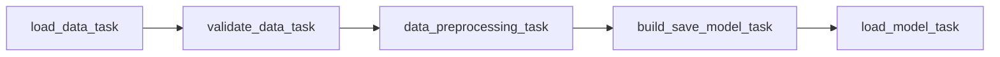

# Airflow Lab 1 – Credit-Card Customer Clustering

[](https://github.com/1AlgoRythm/mlops-lab2/actions/workflows/tests.yml)

An Apache Airflow 3 pipeline that groups credit-card customers with K-Means. It loads a CSV,
checks it, scales three columns, picks the number of clusters with the elbow method, saves the
model, and predicts the cluster of one test customer. It runs in Docker, once a day, and 22
tests check the code.

Based on `Labs/Airflow_Labs/Lab_1` from https://github.com/raminmohammadi/MLOps
(MLOps, DADS 7305, Northeastern University). The original lab README is kept at the end of
this file.

## Contents

- [Overview](#overview)
- [Requirements](#requirements)
- [Installation](#installation)
- [Usage](#usage)
- [Project Structure](#project-structure)
- [Testing](#testing)
- [Changes From the Upstream Lab](#changes-from-the-upstream-lab)
- [Known Limitations](#known-limitations)
- [Lessons Learned](#lessons-learned)
- [Attribution and AI Use](#attribution-and-ai-use)

## Overview

The DAG (directed acyclic graph, Airflow's name for a workflow) is called `Airflow_Lab1`. It has
five tasks that run in a chain:



| Task | What it does |
|---|---|
| `load_data_task` | Reads `dags/data/file.csv`: 8,950 customers, 18 columns. |
| `validate_data_task` | Stops the run if a model column is missing, not numeric or negative, or if fewer than 100 rows are usable. |
| `data_preprocessing_task` | Drops rows that miss a model column, scales the 3 columns to a range of 0 to 1, and saves the scaler. |
| `build_save_model_task` | Fits K-Means for k = 1 to 49, picks the elbow, refits at that k, saves the model and a metrics file. |
| `load_model_task` | Checks the saved model is the elbow model, scales the test customer, refuses a customer outside the training range, and predicts the cluster. |

The model uses three columns: `BALANCE`, `PURCHASES` and `CREDIT_LIMIT`. The other 15 columns
are ignored.

## Requirements

- Docker with Compose 2.14.0 or newer (the Airflow documentation's minimum)
- At least 4 GB of memory for Docker; the Airflow documentation recommends 8 GB
- Tested with Docker 29.8.0 and Docker Compose v5.5.1
- Python 3.12 or 3.13 to run the tests outside Docker

The Airflow image is `apache/airflow:3.3.2`. It runs Python 3.13. This lab needs Airflow 3,
because the DAG imports `airflow.providers.standard`. The upstream lab text mentions
Airflow 2.5.1 and 2.9.2, which do not match its own code.

## Installation

1. Clone the repository and go into it:

   ```bash
   git clone https://github.com/1AlgoRythm/mlops-lab2.git
   cd mlops-lab2
   ```

2. Create the folders Airflow mounts. If they are missing, Docker creates them owned by root.

   ```bash
   mkdir -p ./logs ./plugins ./config
   ```

3. Set up the database and the first user. Wait for `airflow-init exited with code 0`.

   ```bash
   docker compose up airflow-init
   ```

4. Start Airflow in the background:

   ```bash
   docker compose up -d
   ```

5. Open http://localhost:8080 and log in with username `airflow` and password `airflow`.

The compose file installs `pandas`, `scikit-learn` and `kneed` when each container starts. No
`.env` file is needed.

## Usage

Start a run from the web page (open `Airflow_Lab1`, then **Trigger**), or from the terminal:

```bash
docker compose exec airflow-scheduler airflow dags unpause Airflow_Lab1
docker compose exec airflow-scheduler airflow dags trigger Airflow_Lab1
```

A new DAG starts paused. The DAG also runs every day at 06:00 UTC once it is unpaused. The web
page shows times in your browser's time zone.

A run takes about 30 seconds. Open the last task, `load_model_task`, and read its log:

```
Optimal no. of clusters: 8
Saved model has 8 clusters
Scaled test row (inside the training range is 0 to 1): [0.1682, 0.0, 0.2321]
```

A run writes three kinds of file into `dags/model/`. Git ignores them.

| File | Content |
|---|---|
| `model.sav` | The K-Means model fitted at the elbow k |
| `scaler.sav` | The scaler fitted on the training data |
| `metrics_TIME.json` | One file per run: time, rows, k, inertia, silhouette score |

To check the saved model without trusting the log:

```bash
docker compose exec airflow-worker python -c "import pickle; m=pickle.load(open('/opt/airflow/dags/model/model.sav','rb')); print(m.n_clusters)"
```

To stop Airflow, run `docker compose down`. To also delete the database, run
`docker compose down --volumes`.

## Project Structure

```
.
├── .github/workflows/tests.yml   runs the tests on GitHub Actions
├── .gitignore
├── dags/
│   ├── airflow.py                the DAG: 5 tasks, schedule, retries
│   ├── data/
│   │   ├── file.csv              8,950 customers, 18 columns
│   │   └── test.csv              one customer to predict
│   ├── model/                    created by a run, not committed
│   └── src/
│       ├── __init__.py
│       └── lab.py                the function behind each task
├── tests/test_lab.py             22 tests
├── docker-compose.yaml           Apache's Airflow 3.3.2 file, 2 lines changed
├── pytest.ini
├── requirements.txt              packages for the tests
└── README.md
```

## Testing

The tests need no Airflow and no Docker.

```bash
python3 -m venv .venv
source .venv/bin/activate
pip install -r requirements.txt
pytest
```

They check these things:

- `select_k` finds the bend in a curve, and raises an error when there is no elbow.
- `validate_data` accepts a good table and rejects a missing column, a text column, too few rows
  and negative values.
- `data_preprocessing` drops only rows that miss a model column, and saves the scaler.
- `find_out_of_range` accepts values on the edge of the training range and flags the old lab
  test row.
- The saved model has the elbow number of clusters, and a metrics file is written.
- The test customer is scaled with the training scaler before the model predicts.
- The real `file.csv` passes the check, and the real `test.csv` is inside its range.

Result: 22 passed on Python 3.12 (a local environment) and on Python 3.13 (inside the
`apache/airflow:3.3.2` image). Six deliberate breaks of the code, each undoing one change
below, were run against the tests. All six are now caught. One was missed at first, so a test
was added that checks the numbers the model receives.

The GitHub Actions workflow runs the same tests for Python 3.12 and 3.13 on every push to
`main` and on every pull request.

## Changes From the Upstream Lab

The upstream lab is the instructor's code. This repository keeps its structure and changes what
it does. Each change is one commit. "Observed" is what a real run or a check showed.

### Fixed

- **The saved model was the wrong model**
  ([`255a295`](https://github.com/1AlgoRythm/mlops-lab2/commit/255a295)). The lab fitted k from
  1 to 49 and saved the last model, k = 49, while its log said the best k was 8. It now picks
  the elbow, refits at that k and saves that model. A later task stops the run if the two
  numbers differ. Observed: the saved file had 49 clusters before and 8 after (loaded in the
  worker and counted).
- **The test row was not scaled**
  ([`c3ab987`](https://github.com/1AlgoRythm/mlops-lab2/commit/c3ab987)). The model learned
  from data scaled to 0 to 1, but the lab predicted on the raw row, so the answer meant
  nothing. The scaler is now saved and used on the test row. Observed: the scaled test credit
  limit was 8.0622, far outside 0 to 1.
- **The test row itself was out of range**
  ([`22963f5`](https://github.com/1AlgoRythm/mlops-lab2/commit/22963f5)). Its credit limit,
  241514, is above the largest in the data (30000) and appears nowhere in it. Its balance
  matches customer C10002 exactly, so `test.csv` now holds C10002's real values: balance
  3202.467416, purchases 0, credit limit 7000. Observed: scaled row `[0.1682, 0.0, 0.2321]`,
  predicted cluster 2. This customer is part of the training data, so the test is a check that
  the pipeline works and does not measure accuracy.
- **Rows were dropped for a column the model never reads**
  ([`5947650`](https://github.com/1AlgoRythm/mlops-lab2/commit/5947650)). `dropna()` ran over
  all 18 columns and removed 314 rows; 313 of them only lacked `MINIMUM_PAYMENTS`. It now looks
  at the 3 model columns. Observed: 8,950 rows before, 8,949 after. The elbow stayed at 8.

### Added

- **An input check** ([`eab5054`](https://github.com/1AlgoRythm/mlops-lab2/commit/eab5054)):
  the new `validate_data_task`, and a range check on the test row. Observed with temporary
  breaks, restored afterwards: the old test row failed with `CREDIT_LIMIT=241514.0 (training
  range 50.0 to 30000.0)`; a renamed `BALANCE` column failed with `Missing columns:
  ['BALANCE']`, and the three later tasks ended as `upstream_failed`.
- **A quality score and a metrics file for every run**
  ([`c5b74e0`](https://github.com/1AlgoRythm/mlops-lab2/commit/c5b74e0)). The silhouette score
  runs from -1 to 1; higher means better separated clusters. Observed: k = 8, inertia 42.207,
  silhouette 0.4015. The inertia equals the 8th SSE value of the original lab's run (42.2074).
- **Tests** ([`6d37f86`](https://github.com/1AlgoRythm/mlops-lab2/commit/6d37f86)): 22 tests and
  a `requirements.txt`.
- **A daily schedule, retries and a time limit**
  ([`b93d086`](https://github.com/1AlgoRythm/mlops-lab2/commit/b93d086)): daily at 06:00 UTC,
  2 retries one minute apart, a 10-minute limit per task, one active run at a time, tags and a
  DAG description. Observed with temporary breaks: a failing `load_model_task` ran 3 times (the
  first try and 2 retries); `validate_data_task` has no retries and ran once. Next run shown in
  the web page: 2026-10-19 02:00 in a UTC-04:00 browser, which is 06:00 UTC.
- **A GitHub Actions workflow**
  ([`36ade5f`](https://github.com/1AlgoRythm/mlops-lab2/commit/36ade5f)) that runs the tests
  on Python 3.12 and 3.13.

### Changed

- **Owner and description**
  ([`5aa8c9a`](https://github.com/1AlgoRythm/mlops-lab2/commit/5aa8c9a)): the DAG shows the
  author as owner and a description of what it does. The web page showed the new owner at once
  and the description about 30 seconds later.
- **The compose file** ([`5988d69`](https://github.com/1AlgoRythm/mlops-lab2/commit/5988d69),
  [`f58e836`](https://github.com/1AlgoRythm/mlops-lab2/commit/f58e836)): it differs from Apache's
  3.3.2 file by two lines. Airflow's example DAGs are off, and the packages the DAG needs are
  the default for `_PIP_ADDITIONAL_REQUIREMENTS`, so a fresh clone needs no `.env`.

## Known Limitations

- **The DAG file is called `airflow.py`**, the same name as the Airflow package. It works
  inside Airflow. If the `dags/` folder is placed before Airflow on Python's path, the file
  hides the package and the import fails. This happened in a one-off check.
- **The packages are not pinned.** The containers install the newest `pandas`, `scikit-learn`
  and `kneed` at every start. The tested versions were pandas 3.0.5, scikit-learn 1.9.1,
  kneed 0.8.6, numpy 2.5.3 and Python 3.13.
- **`_PIP_ADDITIONAL_REQUIREMENTS` is meant for quick checks.** Apache's own comment in the
  compose file says to build or extend the image for anything else. Every container installs
  the packages again on each start.
- **The login `airflow` / `airflow` is a demo login.** The Airflow documentation says this
  compose setup gives no security guarantees for production.
- **Compose prints a `FERNET_KEY` warning.** It is harmless here. Production needs a real key.
- **The data is the lab's own file, and its source is not stated.** The daily run reads the same
  file every time, so it gives the same result every day. The schedule shows how automation
  works; it does not retrain on new data.
- **Tasks pass the whole table to the next task as a long text string.** This is the lab's
  design. It works for 8,950 rows. A larger table needs files, not XCom.
- **The test customer is part of the training data.** It checks that the pipeline works. It
  does not measure how well the model predicts.
- **GitHub Actions has not been run on this code at the time of writing.** The commands in the
  workflow were run in a fresh environment and passed. Check the badge at the top.

## Lessons Learned

- A log line is not proof. The lab printed "optimal 8" while the saved model had 49 clusters.
  Check the saved file.
- A model must see new data the way it saw training data. Save the scaler with the model.
- A pipeline should refuse bad input with a clear message, not answer with a guess.
- A test that passes is only useful if it can fail. Breaking the code on purpose found a test
  that would not have caught a missing scaling step.
- Compare floats with a tolerance. A scaled maximum came out as 1.0000000000000002.

## Attribution and AI Use

This repository is based on the lab in the course repository linked at the top. Claude (an AI
assistant) wrote the changes, the tests, the workflow and this README at the author's request.
It ran each change and checked the results. The commits from `5aa8c9a` onward carry a
`Co-Authored-By` line.

---

# Original lab README (kept for reference)

# Airflow lab

- In order to install Airflow using docker you can watch our [Airflow Lab1 Tutorial Video](https://youtu.be/exFSeGUbn4Q?feature=shared)
- For latest step-by-step instructions, check out this blog - [AirFlow Lab-1](https://www.mlwithramin.com/blog/airflow-lab1)

### ML Model

This script is designed for data clustering using K-Means clustering and determining the optimal number of clusters using the elbow method. It provides functionality to load data from a CSV file, perform data preprocessing, build and save a K-Means clustering model, and determine the number of clusters based on the elbow method.

#### Prerequisites

Before using this script, make sure you have the following libraries installed:

- pandas
- scikit-learn (sklearn)
- kneed
- pickle

#### Usage

You can use this script to perform K-Means clustering on your dataset as follows:

```python
# Load the data
data = load_data()

# Preprocess the data
preprocessed_data = data_preprocessing(data)

# Build and save the clustering model
sse_values = build_save_model(preprocessed_data, 'clustering_model.pkl')

# Load the saved model and determine the number of clusters
result = load_model_elbow('clustering_model.pkl', sse_values)
print(result)
```

#### Functions

1. **load_data():**
   - *Description:* Loads data from a CSV file, serializes it, and returns the serialized data.
   - *Usage:*
     ```python
     data = load_data()
     ```

2. **data_preprocessing(data)**
   - *Description:* Deserializes data, performs data preprocessing, and returns serialized clustered data.
   - *Usage:*
     ```python
     preprocessed_data = data_preprocessing(data)
     ```

3. **build_save_model(data, filename)**
   - *Description:* Builds a K-Means clustering model, saves it to a file, and returns SSE values.
   - *Usage:*
     ```python
     sse_values = build_save_model(preprocessed_data, 'clustering_model.pkl')
     ```

4. **load_model_elbow(filename, sse)**
   - *Description:* Loads a saved K-Means clustering model and determines the number of clusters using the elbow method.
   - *Usage:*
     ```python
     result = load_model_elbow('clustering_model.pkl', sse_values)
     ```
### Airflow Setup

Use Airflow to author workflows as directed acyclic graphs (DAGs) of tasks. The Airflow scheduler executes your tasks on an array of workers while following the specified dependencies.

References

-   Product - https://airflow.apache.org/
-   Documentation - https://airflow.apache.org/docs/
-   Github - https://github.com/apache/airflow

#### Installation

Prerequisites: You should allocate at least 4GB memory for the Docker Engine (ideally 8GB).

Local

-   Docker Desktop Running

Cloud

-   Linux VM
-   SSH Connection
-   Installed Docker Engine - [Install using the convenience script](https://docs.docker.com/engine/install/ubuntu/#install-using-the-convenience-script)

#### Tutorial

1. Create a new directory

    ```bash
    mkdir -p ~/app
    cd ~/app
    ```

2. Running Airflow in Docker - [Refer](https://airflow.apache.org/docs/apache-airflow/stable/howto/docker-compose/index.html#running-airflow-in-docker)

    a. You can check if you have enough memory by running this command

    ```bash
    docker run --rm "debian:bullseye-slim" bash -c 'numfmt --to iec $(echo $(($(getconf _PHYS_PAGES) * $(getconf PAGE_SIZE))))'
    ```

    b. Fetch [docker-compose.yaml](https://airflow.apache.org/docs/apache-airflow/2.5.1/docker-compose.yaml)

    ```bash
    curl -LfO 'https://airflow.apache.org/docs/apache-airflow/2.5.1/docker-compose.yaml'
    ```

    c. Setting the right Airflow user

    ```bash
    mkdir -p ./dags ./logs ./plugins ./working_data
    echo -e "AIRFLOW_UID=$(id -u)" > .env
    ```

    d. Update the following in docker-compose.yml

    ```bash
    # Donot load examples
    AIRFLOW__CORE__LOAD_EXAMPLES: 'false'

    # Additional python package
    _PIP_ADDITIONAL_REQUIREMENTS: ${_PIP_ADDITIONAL_REQUIREMENTS:- pandas }

    # Output dir
    - ${AIRFLOW_PROJ_DIR:-.}/working_data:/opt/airflow/working_data

    # Change default admin credentials
    _AIRFLOW_WWW_USER_USERNAME: ${_AIRFLOW_WWW_USER_USERNAME:-airflow2}
    _AIRFLOW_WWW_USER_PASSWORD: ${_AIRFLOW_WWW_USER_PASSWORD:-airflow2}
    ```

    e. Initialize the database

    ```bash
    docker compose up airflow-init
    ```

    f. Running Airflow

    ```bash
    docker compose up
    ```

    Wait until terminal outputs

    `app-airflow-webserver-1  | 127.0.0.1 - - [17/Feb/2023:09:34:29 +0000] "GET /health HTTP/1.1" 200 141 "-" "curl/7.74.0"`

    g. Enable port forwarding

    h. Visit `localhost:8080` login with credentials set on step `2.d`

3. Explore UI and add user `Security > List Users`

4. Create a python script [`dags/sandbox.py`](dags/sandbox.py)

    - BashOperator
    - PythonOperator
    - Task Dependencies
    - Params
    - Crontab schedules

    You can have n number of scripts inside dags dir

5. Stop docker containers

    ```bash
    docker compose down
    ```
### Airflow DAG Script

This Markdown file provides a detailed explanation of the Python script that defines an Airflow Directed Acyclic Graph (DAG) for a data processing and modeling workflow.

#### Script Overview

The script defines an Airflow DAG named `your_python_dag` that consists of several tasks. Each task represents a specific operation in a data processing and modeling workflow. The script imports necessary libraries, sets default arguments for the DAG, creates PythonOperators for each task, defines task dependencies, and provides command-line interaction with the DAG.

#### Importing Libraries

```python
# Import necessary libraries and modules
from airflow import DAG
from airflow.operators.python_operator import PythonOperator
from datetime import datetime, timedelta
from src.lab import load_data, data_preprocessing, build_save_model, load_model_elbow
from airflow import configuration as conf
```
The script starts by importing the required libraries and modules. Notable imports include the `DAG` and `PythonOperator` classes from the `airflow` package, datetime manipulation functions, and custom functions from the `src.lab` module.


#### Enable pickle support for XCom, allowing data to be passed between tasks
```python
conf.set('core', 'enable_xcom_pickling', 'True')
```

#### Define default arguments for your DAG
```python
default_args = {
    'owner': 'your_name',
    'start_date': datetime(2023, 9, 17),
    'retries': 0,  # Number of retries in case of task failure
    'retry_delay': timedelta(minutes=5),  # Delay before retries
}
```
Default arguments for the DAG are specified in a dictionary named default_args. These arguments include the DAG owner's name, the start date, the number of retries, and the retry delay in case of task failure.

#### Create a DAG instance named 'your_python_dag' with the defined default arguments
``` python 
dag = DAG(
    'your_python_dag',
    default_args=default_args,
    description='Your Python DAG Description',
    schedule_interval=None,  # Set the schedule interval or use None for manual triggering
    catchup=False,
)
```
Here, the DAG object dag is created with the name 'your_python_dag' and the specified default arguments. The description provides a brief description of the DAG, and schedule_interval defines the execution schedule (in this case, it's set to None for manual triggering). catchup is set to False to prevent backfilling of missed runs.


#### Task to load data, calls the 'load_data' Python function
``` python 
load_data_task = PythonOperator(
    task_id='load_data_task',
    python_callable=load_data,
    dag=dag,
)
```

#### Task to perform data preprocessing, depends on 'load_data_task'
```python 
data_preprocessing_task = PythonOperator(
    task_id='data_preprocessing_task',
    python_callable=data_preprocessing,
    op_args=[load_data_task.output],
    dag=dag,
)
```
The 'data_preprocessing_task' depends on the 'load_data_task' and calls the data_preprocessing function, which is provided with the output of the 'load_data_task'.

#### Task to build and save a model, depends on 'data_preprocessing_task'
```python
build_save_model_task = PythonOperator(
    task_id='build_save_model_task',
    python_callable=build_save_model,
    op_args=[data_preprocessing_task.output, "model.sav"],
    provide_context=True,
    dag=dag,
)
```
The 'build_save_model_task' depends on the 'data_preprocessing_task' and calls the build_save_model function. It also provides additional context information and arguments.

#### Task to load a model using the 'load_model_elbow' function, depends on 'build_save_model_task'
``` python
load_model_task = PythonOperator(
    task_id='load_model_task',
    python_callable=load_model_elbow,
    op_args=["model.sav", build_save_model_task.output],
    dag=dag,
)
```
The 'load_model_task' depends on the 'build_save_model_task' and calls the load_model_elbow function with specific arguments.

#### Set task dependencies
```python
load_data_task >> data_preprocessing_task >> build_save_model_task >> load_model_task
```
Task dependencies are defined using the >> operator. In this case, the tasks are executed in sequence: 'load_data_task' -> 'data_preprocessing_task' -> 'build_save_model_task' -> 'load_model_task'.

#### If this script is run directly, allow command-line interaction with the DAG
```python
if __name__ == "__main__":
    dag.cli()
```
- Lastly, the script allows for command-line interaction with the DAG. When the script is run directly, the dag.cli() function is called, providing the ability to trigger and manage the DAG from the command line.
- This script defines a comprehensive Airflow DAG for a data processing and modeling workflow, with clear task dependencies and default arguments.

### Running an Apache Airflow DAG Pipeline in Docker

This guide provides detailed steps to set up and run an Apache Airflow Directed Acyclic Graph (DAG) pipeline within a Docker container using Docker Compose. The pipeline is named "your_python_dag."

#### Prerequisites

- Docker: Make sure Docker is installed and running on your system.

#### Step 1: Directory Structure

Ensure your project has the following directory structure:

```plaintext
your_airflow_project/
├── dags/
│   ├── airflow.py     # Your DAG script
├── src/
│   ├── lab.py                # Data processing and modeling functions
├── data/                       # Directory for data (if needed)
├── docker-compose.yaml         # Docker Compose configuration
```

#### Step 2: Docker Compose Configuration
Create a docker-compose.yaml file in the project root directory. This file defines the services and configurations for running Airflow in a Docker container.

#### Step 3: Start the Docker containers by running the following command

```plaintext
docker compose up
```

Wait until you see the log message indicating that the Airflow webserver is running:

```plaintext
app-airflow-webserver-1 | 127.0.0.1 - - [17/Feb/2023:09:34:29 +0000] "GET /health HTTP/1.1" 200 141 "-" "curl/7.74.0"
```

#### Step 4: Access Airflow Web Interface
- Open a web browser and navigate to http://localhost:8080.

- Log in with the credentials set in the .env file or use the default credentials (username: admin, password: admin).

- Once logged in, you'll be on the Airflow web interface.

#### Step 5: Trigger the DAG
- In the Airflow web interface, navigate to the "DAGs" page.

- You should see the "your_python_dag" listed.

- To manually trigger the DAG, click on the "Trigger DAG" button or enable the DAG by toggling the switch to the "On" position.

- Monitor the progress of the DAG in the Airflow web interface. You can view logs, task status, and task execution details.

#### Step 6: Pipeline Outputs

- Once the DAG completes its execution, check any output or artifacts produced by your functions and tasks. 